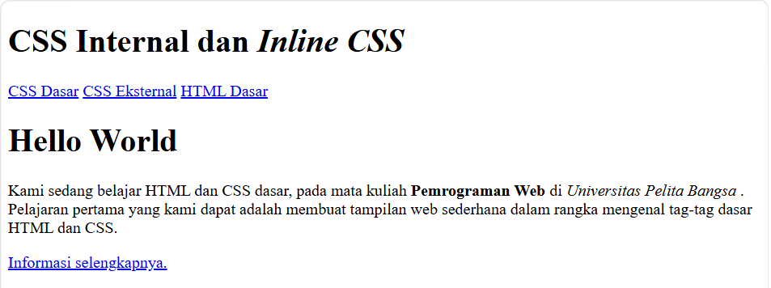
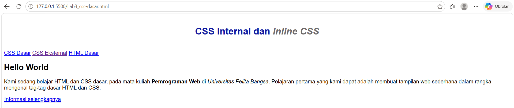
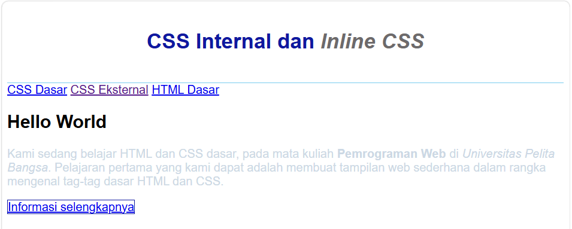
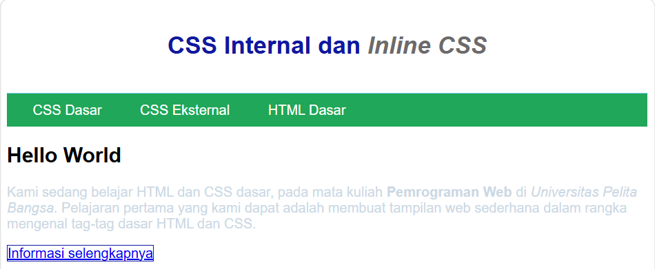
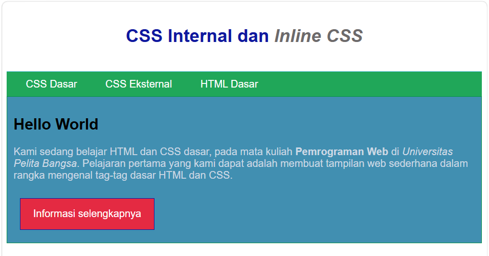
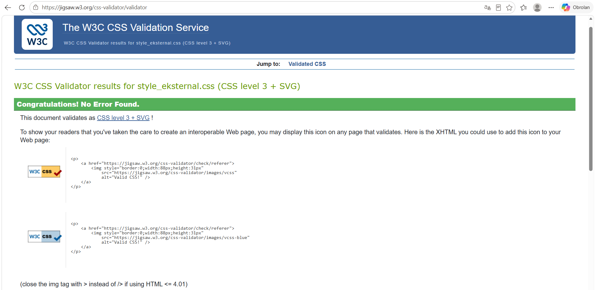

# Praktikum Pemrograman Web

CSS Internal, Inline CSS, CSS Eksternal, dan CSS Selector
Deskripsi
Praktikum ini bertujuan untuk mempelajari dasar-dasar penggunaan CSS (Cascading Style Sheets) dalam mengatur tampilan halaman HTML. Materi yang dipelajari meliputi CSS Internal, Inline CSS, CSS Eksternal, serta penggunaan ID Selector dan Class Selector.

## Tujuan Praktikum

Memahami struktur dasar dokumen HTML.
Memahami cara menggunakan CSS Internal.
Memahami cara menerapkan Inline CSS pada elemen HTML.
Memahami cara menghubungkan file CSS Eksternal dengan HTML.
Memahami penggunaan ID Selector dan Class Selector.
Membuat tampilan halaman web sederhana menggunakan HTML dan CSS.

## Teknologi yang Digunakan
HTML5
CSS3
Visual Studio Code atau editor teks lainnya
Web browser (Google Chrome, Microsoft Edge, atau Mozilla Firefox)
Struktur File

praktikum-pemrograman-web/
├── lab3_css_dasar.html
├── lab3_css_eksternal.html
├── lab1_tag_dasar.html
├── style_eksternal.css
└── README.md

Langkah-Langkah Praktikum

1. Membuat Dokumen HTML

Membuat file lab2_css_dasar.html yang berisi struktur dasar HTML, meliputi:
header sebagai bagian judul halaman.
nav sebagai menu navigasi.
div dengan ID intro sebagai bagian pengenalan.
Elemen heading, paragraf, dan tautan.

## Result

2. Mendeklarasikan CSS Internal

Menambahkan elemen <style> pada bagian <head> untuk mengatur tampilan halaman, seperti:
Jenis font pada halaman.
Tinggi minimum dan garis bawah header.
Ukuran, warna, dan posisi teks heading.
Warna teks miring pada heading.

## Result

3. Menambahkan Inline CSS

Menambahkan atribut style secara langsung pada elemen HTML, misalnya:

    Paragraf dengan CSS Inline

Inline CSS digunakan untuk memberikan gaya langsung pada elemen HTML tertentu.

## Result

4. Membuat CSS Eksternal

Membuat file style_eksternal.css untuk menyimpan aturan CSS secara terpisah dari dokumen HTML.
File CSS eksternal kemudian dihubungkan menggunakan tag berikut pada bagian <head>:
<link rel="stylesheet" href="style_eksternal.css" type="text/css">

## Result

5. Menambahkan CSS Selector

Menambahkan aturan CSS untuk mengatur menu navigasi dan tautan.

nav {
    background: #20A759;
    color: #fff;
    padding: 10px;
}

nav a {
    color: #fff;
    text-decoration: none;
    padding: 10px 20px;
}

nav .active,
nav a:hover {
    background: #0B6B3A;
}

Selain itu, ID Selector dan Class Selector digunakan untuk memberikan gaya pada elemen HTML berdasarkan atribut id dan class.

Contoh ID Selector:

#merah {
    color: red;
}

#serif {
    font-family: serif;
}

#rata-tengah {
    text-align: center;
    font-size: 12pt;
}

Contoh penggunaannya pada HTML:

<h1 id="merah">Heading Berwarna Merah</h1>

Paragraf dengan rata tengah

Paragraf dengan font serif

## Result

## Hasil Pengujian CSS dengan W3C CSS Validator

